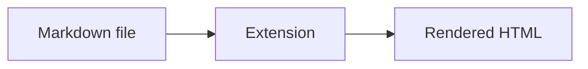
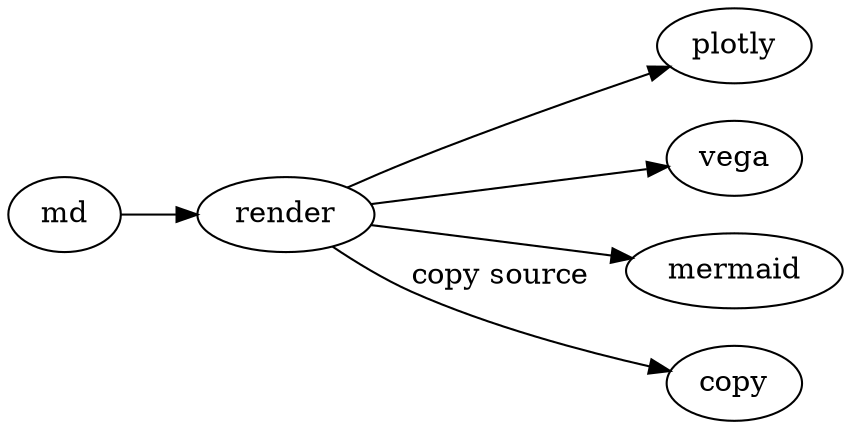
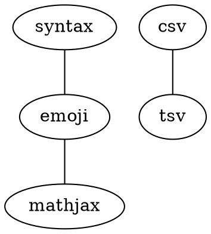

Open this file with the extension loaded (`file:///…/test/features.md`). In the popup **Content** tab, enable everything you want to exercise, then reload this tab.

Checklist:

- [ ] **syntax** — highlighted `js` block below; hover for **Copy**
- [ ] **toc** — sidebar links to headings (if enabled)
- [ ] **emoji** — :smile: :thumbsup:
- [ ] **mathjax** — inline $E=mc^2$ and display $$\\int_0^1 x^2\\,dx = \\frac{1}{3}$$
- [ ] **mermaid** — diagram + Shift+wheel zoom
- [x] **plotly** — interactive chart
- [ ] **abc** — engraved notation
- [ ] **vegalite** — bar chart (`vega-lite`, `vegalite`, and `vega` fences)
- [ ] **graphviz** — `dot` and `graphviz` fences
- [ ] **wavedrom** — timing diagram
- [ ] **csv** / **tsv** — tables (hover funnel filter, column sort asc→desc→original, quoted commas); Reset + Copy = visible rows or original source
- [ ] **copy** — on normal fenced code and tables only (not mermaid/plotly/vega/etc.)

---

## Syntax and copy

Plain fenced code (Prism + copy button):

```js
function greet(name) {
  return `hello, ${name}`
}
console.log(greet('markdown'))
```

```python
def total(items):
    return sum(items)
```

## Emoji

EmojiOne shortnames: :heart: :rocket: :sunglasses:

## MathJax

Inline: $\\alpha + \\beta = \\gamma$

Display:

$$
\\sum_{n=1}^{4} n = 10
$$

## Mermaid



## Plotly

```plotly
{
  "data": [
    {
      "x": [1, 2, 3, 4],
      "y": [10, 15, 13, 17],
      "type": "scatter",
      "mode": "lines+markers",
      "name": "Series A"
    }
  ],
  "layout": {
    "title": "Plotly smoke test",
    "margin": {"t": 40}
  }
}
```

## ABC.js

```abc
X:1
T:Smoke test
M:4/4
L:1/4
K:C
"C" C E G c | G E C2 |
```

## Vega-Lite

`vega-lite` fence:

```vega-lite
{
  "mark": "bar",
  "data": {"values": [
    {"lang": "csv", "n": 1},
    {"lang": "dot", "n": 2},
    {"lang": "abc", "n": 3}
  ]},
  "encoding": {
    "x": {"field": "lang", "type": "nominal"},
    "y": {"field": "n", "type": "quantitative"}
  }
}
```

`vegalite` alias:

```vegalite
{
  "mark": "point",
  "data": {"values": [{"x": 1, "y": 2}, {"x": 2, "y": 4}, {"x": 3, "y": 3}]},
  "encoding": {"x": {"field": "x"}, "y": {"field": "y"}}
}
```

`vega` alias (same renderer):

```vega
{
  "mark": "line",
  "data": {"values": [{"t": 0, "v": 1}, {"t": 1, "v": 3}, {"t": 2, "v": 2}]},
  "encoding": {"x": {"field": "t"}, "y": {"field": "v"}}
}
```

## Graphviz

`dot` fence:



`graphviz` alias:



## WaveDrom

```wavedrom
{
  "signal": [
    {"name": "clk", "wave": "p.....|..."},
    {"name": "req", "wave": "0101010"},
    {"name": "ack", "wave": "0.1.0.1."}
  ],
  "head": {"text": "WaveDrom smoke test"}
}
```

## CSV

Commas and quoted fields:

```csv
name,score,note
Ada,98,"fast, accurate"
Bob,87,steady
Charlie,91,"said ""hi"""
```

## TSV

Tab-separated (tabs between columns):

```tsv
item	qty	price
apples	12	1.25
bananas	6	0.75
cherries	3	4.50
```

## GFM table (compiler)

Pipe tables get the same interactive controls when **csv** is on (hover funnel in the header, sort, copy):

| Feature   | Content toggle |
|-----------|----------------|
| Copy      | always on      |
| CSV fence | `csv`          |
| GFM `\|…\|` | `csv`        |

---

Reload this file after changing Content options. If a block stays raw, confirm the matching toggle is on and that **Allow** file access is granted for `file://` URLs.
